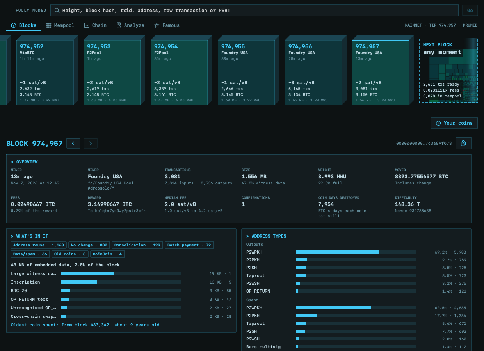
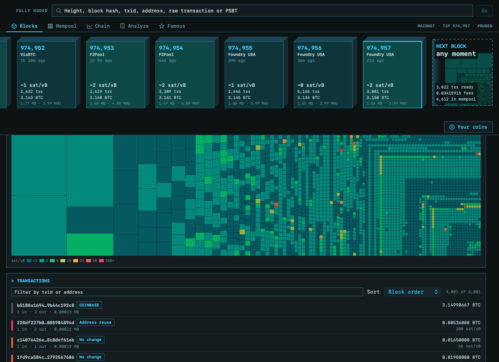
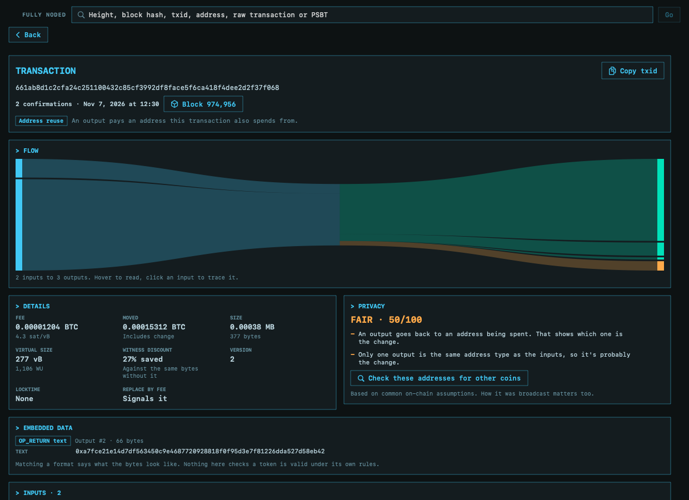
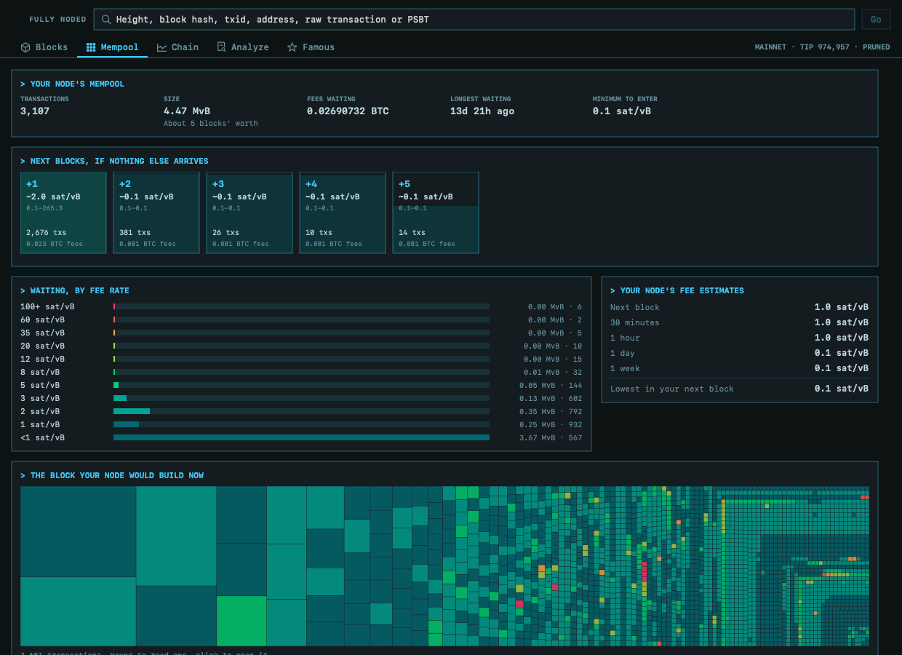
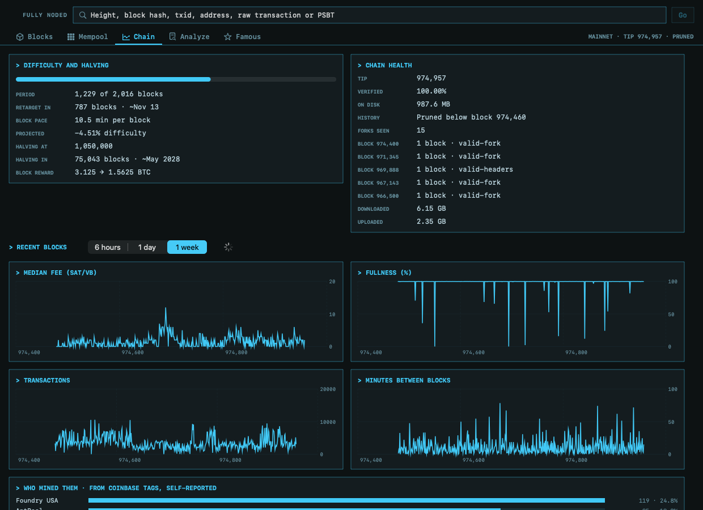
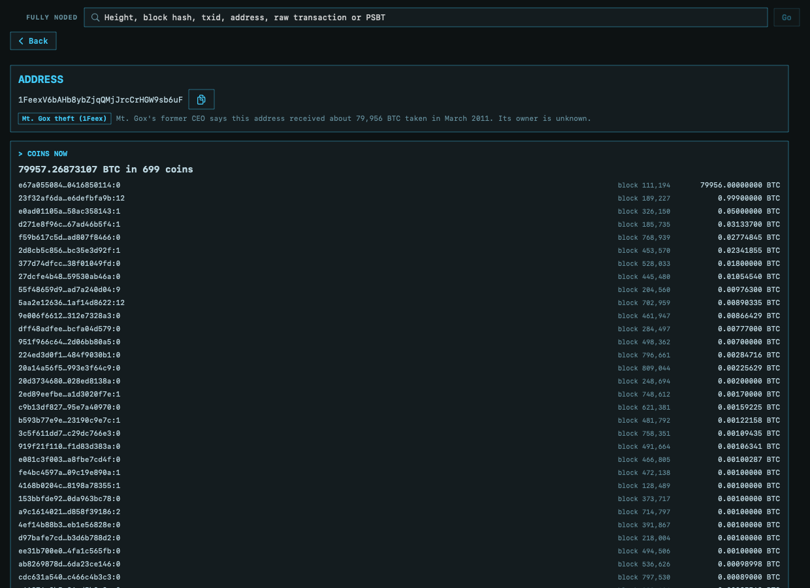
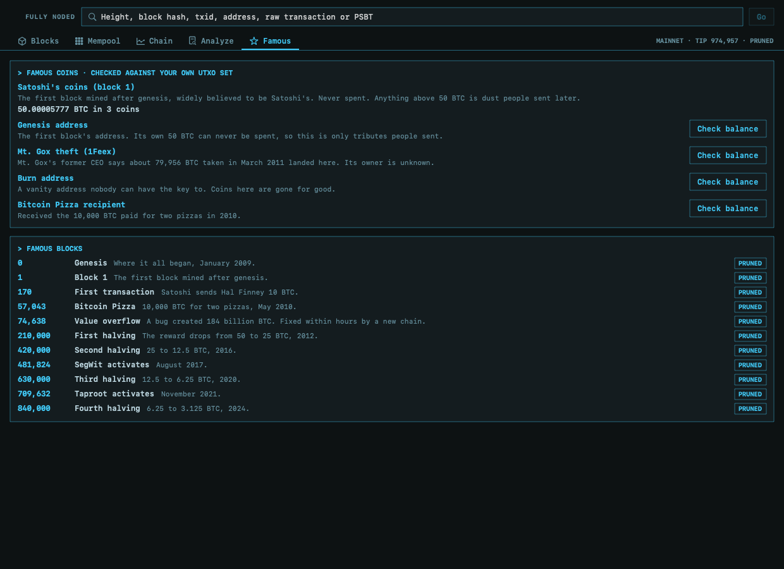

# Block explorer and transaction analysis

Fully Noded Server sits next to your node, so it can read things no phone over Tor and no website can:
whole blocks at once, your whole UTXO set, and your mempool at the moment a block arrives. Nothing you
look at leaves your Mac. The only thing it ever asks your node to change is starting or stopping a scan.

Open **Block Explorer** in the sidebar. The search box at the top takes anything: a height, block hash,
txid, address, raw transaction or PSBT. It's on whichever network FN-Server is using.

## Blocks

Blocks run left to right, newest on the right, with the block your node would build now at the far end.
Its tiles are its real transactions. **Older** at the left end brings in more.

Selecting a block reads all of it, and for every transaction works out its fee, the age of the coins
it spends, what kind of transaction it looks like and what data it carries:

- **What's in it**: click a category to filter the map and the list.
- **Embedded data**: how much of the block it is, by protocol.
- **Address types**: what it paid to and what it spent.
- **Coin days destroyed**, the oldest coin spent, and the miner's own coinbase message.
- **Compared with your mempool**: for a block that arrives while the page is open, how many of its
  transactions your node had already seen, and what the miner left out of the block your node would have built.

The block map is every transaction: area is its size, colour is its fee rate. Hover to read one, click
to open it. Sort or filter the list by fee rate, size, value, oldest coins, txid or address.

If a block's coinbase says a solo miner won it, there's a small party. That's self-reported, like every
miner tag.

## Transactions

- **Flow**: where the money goes, with the fee in amber. Hover to read a ribbon, click an input to trace it.
- **Privacy**: a grade with its reasons, from common chain-analysis assumptions, and which output is
  likely change. A good grade doesn't make a transaction private.
- **Check these addresses for other coins**: asks your own UTXO set about every address in the
  transaction, in about a minute, without telling anyone which ones you care about.
- **Embedded data**: decoded automatically. A protocol's name means the bytes match its format, not
  that a token is valid under its own rules.
- **Spent · find where**: Bitcoin Core keeps no index of spends, but FN-Server can look for the spend in
  your node's own blocks, at about 30 blocks a second.
- **In your mempool**: its effective rate, its unconfirmed parents and children, and whether it's in
  the block your node would build now.

Without `txindex`, searching for a txid looks through your node's blocks from the newest back. **Stop**
ends it.

## Analyze

Paste a raw transaction, a PSBT or a txid, or open a file (including a binary `.psbt`), to get all of the
above **before** it goes anywhere. Nothing is broadcast:

- A raw transaction shows whether your node would accept it, and why not.
- A PSBT shows what it still needs and how many signatures are missing. Version 0 and version 2 both work.

## Mempool

The next blocks if nothing else arrives, what's waiting by fee rate, your node's fee estimates, the block
it would build now, and the best payers. New transactions keep arriving, so treat the projection as a
rough picture. On Core 32 or later it uses the rates miners actually work from (chunk rates).

## Chain

Difficulty and the halving, chain health, charts of fees, fullness, transactions and block times, who
mined recent blocks, hashrate, and which peers bring you blocks. Long ranges fill in as they load. On a
pruned node they stop at the oldest block you still have.

## Addresses

An address's coins right now, from your UTXO set. This works on a pruned node and takes about a minute.
**Find every block that touched it** needs a block filter index: add `blockfilterindex=1` to your
`bitcoin.conf` and restart your node. It takes a while to build, and a few GB.

## Famous

Satoshi's coins, the genesis address, the Mt. Gox theft and more, checked against your own UTXO set, and
landmark blocks to visit. A pruned node only has the headers of the old ones.

## Your coins

**Your coins** on the Blocks tab lists a loaded wallet's coins by block, and marks those blocks on the strip.

## What it can't do

There's no fiat, on purpose: an exchange rate is the one thing that would have to come from outside
your Mac.
